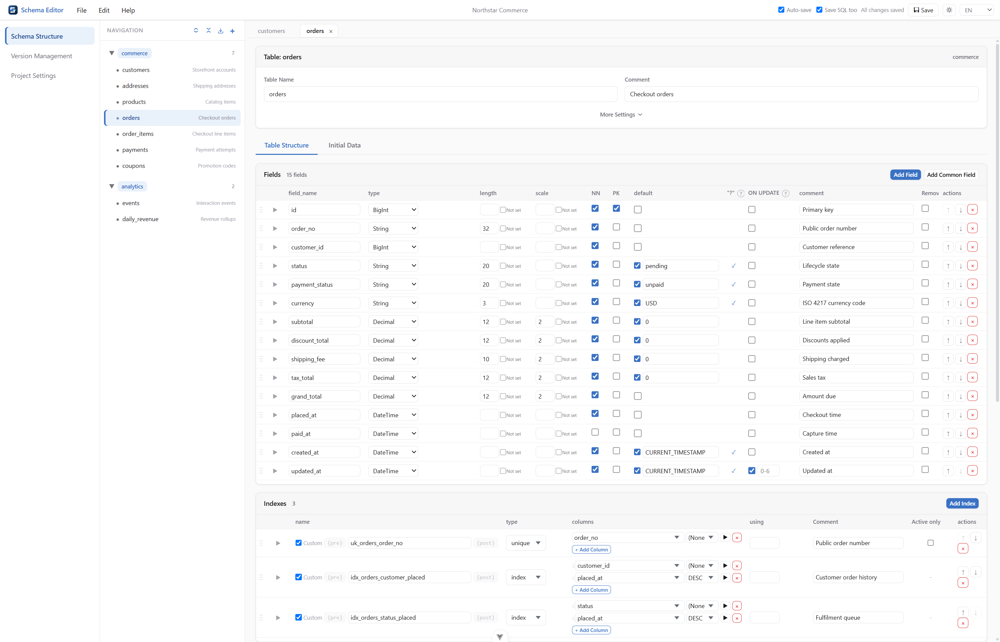

<p align="center">
  
</p>

<h1 align="center">schema-editor</h1>

<p align="center"><em>数据库 Schema JSON 可视化编辑器</em></p>

<p align="center">
  <a href="./README.md">English</a> | 简体中文
</p>

<p align="center">
  <a href="https://github.com/zhang-brook/schema-editor">GitHub</a> · <a href="https://zhang-brook.github.io/schema-editor/">在线预览</a>
</p>

<p align="center">
  
</p>

通过图形界面编辑 JSON 格式的 Schema 定义，实时预览 MySQL / PostgreSQL 建表语句，并将结果导出为 JSON 或 SQL 文件。

## 功能

- **可视化编辑**：树形导航（Schema > Table），直观管理多 Schema 下的表结构
- **方言支持**：字段类型、索引配置均支持 MySQL / PostgreSQL / SQLite 差异化覆盖
- **字段管理**：表格化编辑字段属性，支持增删改查、注释开关、拖拽排序
- **索引管理**：定义主键、唯一索引、普通索引，含方言覆盖配置
- **SQL 实时预览**：编辑时实时预览当前表的建表语句及初始数据 INSERT 语句
- **初始数据编辑**：支持表格模式 / JSON 模式编辑初始数据，按表存放于 `current/schemas/<schema>/<table>/initial-data.json`
- **公共配置**：编辑 `common.json` 中的公共字段引用（`common_used_fields`）和默认配置
- **按需保存**：直接读写本地文件夹，每次改动只写入受影响的文件；「同步保存 SQL」依赖「实时保存」，可以只实时保存项目文件而把 `output/` 下的 SQL 留给手动保存
- **Git 仓库数据源**：可把 GitHub / Gitee / 自建 Gitea 仓库的某个子目录挂载为项目，无需本地克隆；该模式不做实时保存，改动由「提交」弹窗确认后写入远端分支
- **离开保护**：有未保存改动时，关闭项目、换文件夹或重新加载前会询问「保存 / 不保存 / 取消」

## 快速开始

```sh
# 安装依赖
pnpm install

# 启动开发服务器
pnpm dev

# 构建生产版本
pnpm build
```

## 桌面版（Windows / macOS / Linux）

除网页版外，还可以本地应用方式运行：桌面版与网页版共用同一套界面与功能，打开项目文件夹时使用系统自带的文件夹选择器。桌面端依赖（含 Electron 二进制）随上面的 `pnpm install` 一并安装。发布时 CI 会在 [Releases](https://github.com/zhang-brook/schema-editor/releases) 附上各平台安装包：Windows `schema-editor-vX.Y.Z-windows-x64-setup.exe` / `-portable.exe`、macOS `schema-editor-vX.Y.Z-macos-universal.dmg`、Linux `schema-editor-vX.Y.Z-linux-x86_64.AppImage` / `-linux-amd64.deb`；安装版与 AppImage 可在「关于」弹窗检查并安装新版本。macOS 包当前未签名，首次打开需在系统设置中允许。

```sh
# 开发模式：开发服务器 + 桌面窗口
pnpm desktop:dev

# 本地打包当前平台的安装包（输出到 app/desktop/release）
pnpm desktop:dist
```

## 使用说明

1. **打开文件夹**：点击顶部「文件 → 打开文件夹」（Ctrl+O / ⌘O），选择一个空文件夹或已有项目文件夹（含 `common.json` + `current/`），也可以直接把文件夹拖入窗口
2. **打开 Git 仓库**：点击「文件 → 打开 Git 仓库」，粘贴仓库地址（可带上分支与子目录，如 `https://github.com/owner/repo/tree/main/projects/demo`）和访问令牌；勾选「记住令牌」会把令牌按站点保存在浏览器中，下次自动填入。这种模式下工具栏的「保存」变成「提交」，弹窗列出待提交文件并允许修改提交信息，确认后推送到该分支；远端已有新提交时会拒绝本次提交，先「从仓库重新加载」再提交
3. **导航**：左侧树形面板展开 Schema 查看表列表，点击表名切换编辑目标
4. **编辑**：右侧面板可编辑表属性、字段、索引，切换方言标签查看不同数据库的 SQL 预览
5. **初始数据**：展开「Initial Data」面板编辑表的初始数据
6. **保存**：右上角「实时保存」控制项目文件、「同步保存 SQL」控制 `output/` 下的派生 SQL（勾选同步保存 SQL 会连带开启实时保存，关闭实时保存会连带关闭同步保存 SQL）；关掉后改动只留在内存，由「保存」（Ctrl+S / ⌘S）写入磁盘，标题与工具栏会标记未保存状态。「保存」随时可用：即使当前没有改动，也会重写全部项目文件并重建 `output/` 下的 SQL（例如该目录被外部删除后）
7. **重新加载**：若手动修改了本地文件，用「文件 → 从磁盘重新加载」（Alt+R）放弃内存修改并重新读取

> 自建 Gitea 需要在服务端开启跨域（`app.ini` 中 `[cors] ENABLED = true`），浏览器才能直接访问它的 API。

## 目录结构约定

> 您可以创建一个空文件夹，然后在可视化界面中进行编辑即可，无需手动创建下列文件

项目要求被编辑的文件夹遵循以下结构：

```
your-schema-folder/
├── common.json          # 公共字段引用和默认配置（与版本无关）
├── current/             # 当前正在编辑的版本（固定名）
│   ├── database.json    # schema 排序等当前版本相关配置
│   └── schemas/
│       └── <schema>/    # 文件名友好的模式名（处理掉特殊字符）
│           ├── schema.json  # schema 原始名称 + table 排序
│           └── <table>/     # 文件名友好的表名
│               ├── table.json        # 表配置项（字段定义、索引等）
│               └── initial-data.json # 行内化的初始数据 (可选)
└── output/<dialect>/    # 生成的建表 / 初始数据 SQL（派生文件，仅在内容变化时重写）
```

> 旧结构（`schemas/<schema>.json` + 平行 `initial-data/` 目录）仍可被识别，首次打开时会提示升级到上述新结构。

---

如需了解项目架构或参与开发，请参阅 [DEVELOPMENT.zh-CN.md](./DEVELOPMENT.zh-CN.md)。

## 参与贡献

欢迎提交 Issue 和 Pull Request。提交信息与代码注释请使用英文；文档默认提供英文版，并同步维护中文版（`.zh-CN.md`）。
